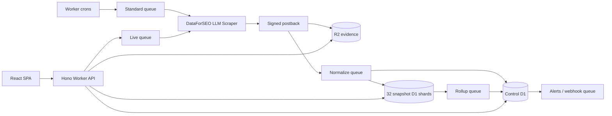

# AI Visibility Tracker

Self-hosted ChatGPT web visibility tracking on Cloudflare. AI Visibility Tracker schedules
DataForSEO LLM Scraper runs, stores normalized evidence, and reports citations,
retrieved domains, brand mentions, shopping results, and visibility changes.

The implementation is designed for multi-user installations and at least one
million runs per month. It uses a control D1 database plus 32 snapshot D1
shards, queue-backed ingestion, and R2 for raw evidence and exports.

## What is included

- React 19 dashboard with projects, tracked prompts, snapshots, evidence,
  domains, brands, products, alerts, exports, users, and settings
- Local password authentication, CSRF protection, role-based access, manual
  invitation links, and manual password-reset links
- Daily and weekly schedules evaluated in each query's IANA timezone
- DataForSEO Standard postbacks for monitoring and Live Advanced runs for
  manual refreshes
- Recovery through `tasks_ready`, signed provider tags, idempotent ingestion,
  queue retries, and dead-letter queues
- Normalized D1 analytics and streamed gzip evidence/export storage in R2
- In-app alerts and HMAC-signed HTTPS webhooks
- Twelve-month hot snapshots, two-year raw evidence, opt-in 90-day HTML
  evidence, and seven-day export retention

## Architecture



The control database owns tenancy, auth, scheduling, job state, compact
snapshot indexes, rollups, alerts, and exports. A tracked query is assigned to
one snapshot shard for its lifetime, keeping detail reads local and avoiding
cross-database joins.

## Requirements

- Node.js 24 or newer
- pnpm 11
- A Cloudflare account with Workers Paid recommended
- DataForSEO API credentials with ChatGPT LLM Scraper access

## Local development

```bash
pnpm install
cp .dev.vars.example .dev.vars
pnpm db:migrate:local
pnpm dev
```

Fill `.dev.vars` with DataForSEO credentials and three independently generated,
high-entropy secrets. `BOOTSTRAP_TOKEN` is entered once in the first-run setup
screen. `APP_CRYPTO_KEY` signs provider job tags; changing it invalidates
outstanding jobs. `DATAFORSEO_WEBHOOK_TOKEN` protects the postback endpoint.

For locally posted Standard tasks, DataForSEO must be able to reach the Worker.
Use a deployed staging Worker or a secure public tunnel and ensure the
workspace's `public_base_url` points to it. Live manual runs work without an
inbound postback.

## Cloudflare deployment

Authenticate Wrangler, then run:

```bash
pnpm deploy
pnpm r2:lifecycle
```

Wrangler provisions resources declared in `wrangler.jsonc` when they do not
exist. The deploy script publishes the Worker and applies the control migration
plus the same snapshot migration to all 32 shards. The lifecycle command
replaces the `ai-tracker-evidence` bucket lifecycle with the checked-in
prefix-specific retention policy.

Set production secrets before completing setup:

```bash
pnpm wrangler secret put DATAFORSEO_LOGIN
pnpm wrangler secret put DATAFORSEO_PASSWORD
pnpm wrangler secret put DATAFORSEO_WEBHOOK_TOKEN
pnpm wrangler secret put APP_CRYPTO_KEY
pnpm wrangler secret put BOOTSTRAP_TOKEN
```

After publishing this repository, a Cloudflare Deploy button can target:

```text
https://deploy.workers.cloudflare.com/?url=https://github.com/OWNER/REPOSITORY
```

Replace `OWNER/REPOSITORY` with the public repository path. Secrets are prompted
because they are declared as required in `wrangler.jsonc`; D1, R2, and Queue
resources are declared in the same file.

## Operations

| Schedule | Responsibility |
|---|---|
| Every 5 minutes | Enqueue due queries and recover stale submissions |
| Every 15 minutes | Collect failed/missed postbacks from `tasks_ready` |
| Daily 03:00 UTC | Expire sessions, tokens, jobs, indexes, and hot snapshots |
| Sunday 04:00 UTC | Refresh locale catalog and reconcile metric outboxes |

The Settings health page reports recent job and ingest failures. Cloudflare
observability is enabled, and each scheduled handler emits structured metrics.
Webhook destinations receive HMAC SHA-256 signatures in
`x-ai-tracker-signature`; secrets are shown once.

HTML evidence is off by default and can be enabled per project. Raw prompts
should not contain personal data. R2 objects are private and evidence downloads
are authorized through the Worker.

## Verification

```bash
pnpm typecheck
pnpm lint
pnpm test
pnpm build
pnpm deploy:dry
```

The unit tests cover validation, URL/domain normalization, DST-aware schedules,
and date-bound utilities. CI runs the full verification sequence on every pull
request.

## Repository map

- `src/app` — React dashboard
- `src/worker` — API, ingestion, analytics, alerts, and exports
- `src/shared` — request schemas and queue contracts
- `migrations/control` — tenancy, orchestration, and rollup schema
- `migrations/snapshot` — detailed snapshot schema
- `infrastructure` — R2 lifecycle configuration
- `scripts/migrate.mjs` — applies migrations across all D1 bindings
- `ai-tracker-prd.md` — source product and architecture requirements

## License

MIT
