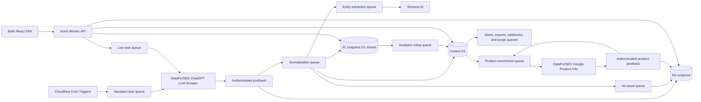
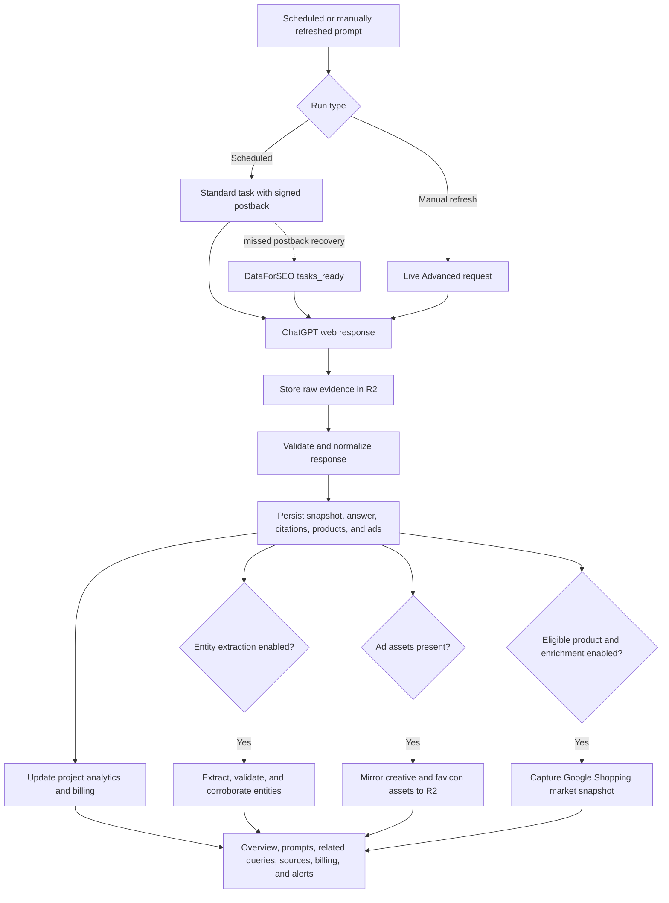
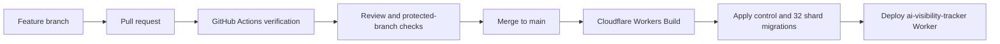

<p align="center">
  
</p>

<h1 align="center">Belki</h1>

<p align="center">
  <strong>Know when AI recommends you, and when it doesn't.</strong>
</p>

<p align="center">
  Self-hosted ChatGPT visibility, competitor, citation, shopping, entity, and advertising intelligence on Cloudflare.
</p>

Belki schedules and captures DataForSEO ChatGPT LLM Scraper responses, retains
the underlying evidence, and turns those responses into project-level visibility
analytics. It is designed for multi-user installations and at least one million
runs per month.

## What Belki tracks

- **Visibility and competition:** brand visibility, Share of Voice, visibility
  gap against the leading competitor, daily competitor trends, and annotations
  showing when the monitored prompt set changed.
- **Prompts and snapshots:** daily or weekly scheduled prompts, manual refreshes,
  bulk creation, tags, locale settings, captured answers, tables, citations,
  retrieved results, and fan-out queries.
- **Related queries:** recurring fan-out searches across prompts, tracking status,
  response history, and contextual cited and retrieved URLs—with one-click prompt
  creation for valuable untracked topics.
- **Citation sources:** citation rate, source share, domain trends, source detail,
  and links back to the exact captured response.
- **Entities:** cross-industry discovery of brands, companies, people, and places;
  answer-text validation; evidence and corroboration; manual tracking; and guarded
  automatic competitor tracking.
- **Ads:** sponsored-result detection, ad appearance rate, advertiser activity,
  creatives, destinations, observed positions, retained image/favicon assets, and
  the prompts and snapshots in which each ad appeared.
- **Shopping:** products observed in AI answers, merchant labels, price, rating,
  reviews, appearance history, and optional Google Shopping enrichment with
  specifications, seller offers, availability, market pricing, and review data.
- **Billing and operations:** provider charges and estimated Workers AI costs by
  project and workload, daily trends, project-level warnings, alerts, exports,
  webhooks, health diagnostics, users, and role-based access.

### Metric definitions

| Metric | Definition |
|---|---|
| Visibility | Completed responses mentioning the tracked brand ÷ all completed responses |
| Share of Voice | Tracked-brand appearances ÷ appearances across the owned brand and every tracked competitor |
| Visibility gap | Owned-brand visibility minus the visibility of the leading tracked competitor, in percentage points |
| Citation rate | Completed responses containing at least one citation ÷ all completed responses |
| Ad appearance rate | Completed responses containing at least one sponsored result ÷ all completed responses |

Share of Voice is only available after a competitor is tracked. The overview
plots the owned brand and the four most visible competitors while calculating
Share of Voice across every tracked competitor.

## Product behavior and defaults

- Settings are scoped explicitly: feature switches belong to the selected
  **project**, project administration and webhooks belong to the **workspace**,
  and installation checks live under **Diagnostics**.
- Named entity extraction is enabled for new projects. Automatic competitor
  tracking is opt-in and requires repeated, corroborated evidence.
- Google Shopping enrichment is opt-in for new projects and only runs when a
  captured product includes a compatible Google Shopping identifier.
- The Ads navigation item appears automatically after the selected project has
  detected a sponsored result. Ads remain visible in their originating snapshot.
- Provider and inference costs are reported in Billing, with aggregate and
  per-project views. Product-enrichment and entity-extraction warning thresholds
  are project-specific and do not stop workloads automatically.
- Original response-page HTML is opt-in per project. Normalized raw results are
  retained for 730 days, HTML for 90 days when enabled, hot snapshots for 12
  months, and exports for 7 days.

## Architecture

Belki runs as a React single-page application and Hono API in one Cloudflare
Worker. A control D1 database stores tenancy and aggregate state; 32 snapshot D1
shards distribute detailed captures. R2 retains raw evidence, optional HTML,
exports, and mirrored ad assets.



The control database owns workspaces, users, projects, tracked prompts,
scheduling, job state, compact snapshot indexes, rollups, ads, entities,
enrichment state, alerts, billing, and exports. Each tracked prompt is assigned
to one snapshot shard for its lifetime, avoiding cross-database joins on detail
reads.

### Capture and analysis flow



## Requirements

- Node.js 24 or newer
- pnpm 11
- A Cloudflare account with Workers Paid
- A Cloudflare Email Sending domain for optional invitation emails
- DataForSEO credentials with ChatGPT LLM Scraper access
- DataForSEO Merchant Google Product Info access for optional Shopping enrichment

Workers Paid is required by the default topology because it declares one control
database and 32 snapshot databases. Workers Free currently permits fewer D1
databases than this architecture requires.

The Worker includes an `EMAIL` binding restricted to
`noreply@notifications.getbelki.com`. Invitations always return a copyable link;
administrators can optionally submit the same invitation through Cloudflare Email
Sending. Change `EMAIL_FROM_ADDRESS` and the binding's allowed sender together in
`wrangler.jsonc` when deploying under another onboarded sending domain.

## Local development

```bash
pnpm install
cp .dev.vars.example .dev.vars
pnpm db:migrate:local
pnpm dev
```

Configure these values in `.dev.vars`:

| Secret | Purpose |
|---|---|
| `DATAFORSEO_LOGIN` | DataForSEO API login |
| `DATAFORSEO_PASSWORD` | DataForSEO API password |
| `DATAFORSEO_WEBHOOK_TOKEN` | Authenticates ChatGPT and product-info postbacks |
| `APP_CRYPTO_KEY` | Signs provider job tags; changing it invalidates outstanding jobs |
| `BOOTSTRAP_TOKEN` | One-time token entered during the first-run owner setup |

Use independent, high-entropy values for the three application secrets. For
locally submitted Standard tasks, DataForSEO must be able to reach the Worker.
Use a deployed staging Worker or a secure public tunnel and set the workspace
`public_base_url` accordingly. Live manual runs do not require an inbound
postback.

## Production deployment

This repository deploys through GitHub and a protected `main` branch. Do not
deploy production directly from a feature branch or local checkout.



### Maintainer workflow

1. Create a feature branch and commit the intended changes.
2. Push the branch and open a pull request against `main`.
3. Wait for type checking, linting, tests, and the production build to pass.
4. Review and merge the pull request.
5. Cloudflare Workers Builds detects the `main` update and runs the configured
   build and deploy commands.
6. Confirm the Workers Build completed and smoke-test the affected authenticated
   page in production.

The Cloudflare Git integration uses `/` as its root directory, `pnpm build` as
the build command, and `pnpm deploy` as the deploy command. The deploy script
runs remote control and snapshot migrations before publishing the
`ai-visibility-tracker` Worker.

### Connect a private GitHub repository

1. In Cloudflare, open **Workers & Pages**, select **Create application**, and
   choose **Import a repository**.
2. Authorize the Cloudflare GitHub App for the private repository.
3. Select `main` as the production branch and use the build/deploy commands
   above.
4. Add the five required values as encrypted runtime secrets under
   **Settings → Variables & Secrets**.
5. From an authenticated checkout, run `pnpm r2:lifecycle` once to apply the
   checked-in evidence-retention rules.

### Self-hosting alternatives

For a public fork, the Cloudflare Deploy button can provision the declared D1,
R2, Queue, Workers AI, and secret bindings and connect the fork to Workers
Builds:

[](https://deploy.workers.cloudflare.com/?url=https://github.com/Xyborg/AI-Visibility-Tracker)

For a manual self-hosted deployment, authenticate Wrangler, configure the five
production secrets, and run:

```bash
pnpm build
pnpm deploy
pnpm r2:lifecycle
```

`pnpm deploy` applies all control migrations and the same snapshot migrations
to all 32 shards before invoking `wrangler deploy`. The lifecycle command
replaces the lifecycle configuration of the `ai-tracker-evidence` bucket with
the checked-in prefix-specific retention policy.

## Operations

| Schedule | Responsibility |
|---|---|
| Every 5 minutes | Enqueue due prompts, recover stale prompt jobs, enqueue eligible product enrichments, and reconcile product-enrichment jobs |
| Every minute | Recover missed ChatGPT and product postbacks, reconcile prompt purges, entity extraction and ad assets, and advance analytics backfills |
| Daily at 03:00 UTC | Expire sessions, tokens, ingest events, jobs, indexes, and hot snapshots |
| Sunday at 04:00 UTC | Refresh the DataForSEO locale catalog and reconcile metric outboxes |

The Diagnostics tab reports control database, snapshot-shard, and runtime
binding health. Cloudflare observability is enabled, and scheduled handlers emit
structured metrics. Webhook destinations receive HMAC-SHA256 signatures in
`x-ai-tracker-signature`; signing secrets are displayed only once.

### Security and retention

- Local password authentication uses CSRF protection and the `owner`, `admin`,
  `editor`, and `viewer` roles.
- Invitations and password resets use manually shared, expiring links.
- DataForSEO postbacks require the webhook token and a valid signed job tag.
- R2 objects are private and evidence downloads are authorized through the
  Worker.
- Raw prompts should not contain personal or sensitive data.
- Permanent prompt deletion asynchronously removes D1 and R2 evidence while
  retaining anonymous billing totals for accurate reporting.

## Verification

```bash
pnpm typecheck
pnpm lint --max-warnings 0
pnpm test
pnpm build
pnpm deploy:dry
```

CI runs type checking, linting, tests, and the production build for every pull
request. Tests cover contracts, entity extraction and corroboration,
URL/domain normalization, DST-aware schedules, analytics reporting, ads,
product enrichment, provider costs, evidence parsing, and the React views used
to render captured answers.

## Repository map

- `src/app`: Belki React dashboard and authenticated product experience
- `src/worker`: Hono API, ingestion, analytics, automation, and scheduled work
- `src/shared`: request schemas and queue contracts
- `migrations/control`: tenancy, orchestration, analytics, entities, ads,
  enrichment, billing, and project settings
- `migrations/snapshot`: detailed response, citation, product, and ad evidence
- `infrastructure`: R2 lifecycle configuration
- `scripts/migrate.mjs`: applies migrations to the control database and all 32
  snapshot shards
- `ai-tracker-prd.md`: original product and architecture requirements

## License

Apache-2.0
