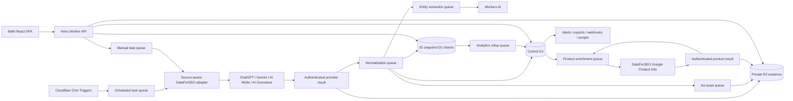
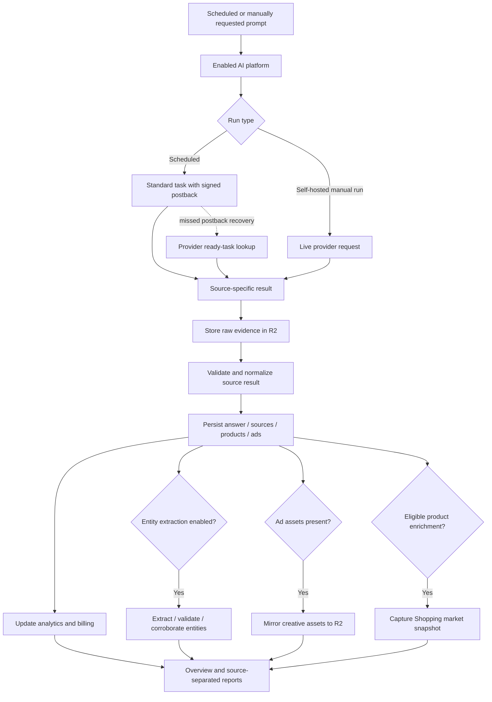
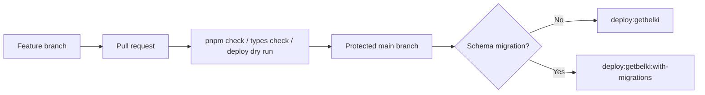

<p align="center">
  
</p>

<h1 align="center">Belki</h1>

<p align="center">
  <strong>The first open-source AI search intelligence platform.</strong>
</p>

<p align="center">
  Self-hosted or managed on Cloudflare. Track how your brand and competitors
  appear across AI-generated answers, citations, recommendations, ads, and
  shopping results.
</p>

<p align="center">
  <a href="https://deploy.workers.cloudflare.com/?url=https://github.com/GetBelki/belki">
    
  </a>
</p>

<p align="center">
  <em>Know when AI recommends you, and when it doesn't.</em>
</p>

Belki schedules prompts across ChatGPT, Gemini, Google AI Mode, and Google AI
Overviews, captures the returned answers and source evidence, and turns those
captures into project-level visibility analytics. It supports multiple isolated
workspaces, multiple brands per workspace, and source-specific reporting while
retaining the evidence behind every metric.

The default Cloudflare topology is designed for at least one million runs per
month on larger self-hosted installations.

## Contents

- [Supported AI platforms](#supported-ai-platforms)
- [Features](#features)
- [Metrics](#metrics)
- [Architecture](#architecture)
- [Requirements](#requirements)
- [Quick start: self-host on Cloudflare](#quick-start-self-host-on-cloudflare)
- [Local development](#local-development)
- [Production deployment](#production-deployment)
- [Managed cloud](#managed-cloud)
- [Operations](#operations)
- [Security and retention](#security-and-retention)
- [Verification](#verification)
- [Repository map](#repository-map)
- [Contributing and security](#contributing-and-security)

## Supported AI platforms

Each enabled platform runs every active prompt independently. The overview can
combine enabled platforms, while prompts, responses, citations, related queries,
entities, ads, and shopping data remain separated by their originating source.

| Platform | Data captured |
|---|---|
| ChatGPT Search | Answers, citations, retrieved sources, fan-out queries, entities, ads, shopping blocks, and retained page evidence |
| Gemini | Answers, citations, retrieved sources, fan-out queries, and entities |
| Google AI Mode | Answers, cited and retrieved sources, fan-out queries, and entities |
| Google AI Overviews | Whether an AI Overview appeared, its answer text, cited sources, and entities |

ChatGPT is enabled by default. Additional sources must be available in the
deployment and allowed by the workspace plan. Claude and Perplexity are not part
of the current release.

## Features

Belki has two deployment modes:

- **Self-hosted:** the repository default. The installation owner supplies the
  Cloudflare resources and DataForSEO credentials. Manual prompt runs are
  available, and subscription billing is disabled.
- **Managed cloud:** a hosted subscription service using platform credentials,
  Stripe billing, plan limits, signup codes, and protected operator tools.

Unless labeled otherwise, the features below are available in both modes.

### Workspaces, projects, and onboarding

- Users can belong to multiple isolated workspaces and switch between them
  without mixing projects, memberships, billing, or analytics.
- Guided onboarding creates the first project and its initial prompts.
- Every project defines an owned brand and optional primary domain for mention,
  citation, seller, and competitor comparisons.
- Projects select one or more available AI platforms, subject to the active plan.
- Workspace owners and administrators can create and edit projects. Archived
  projects retain their history and can be restored when the plan has room.
- Project and source selectors preserve the relevant report context and safely
  return from detail pages when the selected scope changes.

### Visibility overview

The 30-day overview provides an **All platforms** rollup and an individual tab
for every enabled source. It includes:

- owned-brand visibility, Share of Voice, visibility gap, and completed capture
  counts;
- AI Overview appearance counts when Google AI Overviews is selected;
- daily owned-brand and competitor visibility, Share of Voice, or average
  first-mention position trends;
- prompt-set change annotations so changes in the monitored sample are visible;
- leading citation-source trends, with the project domain identified separately;
- leading competitors, top products, and recently detected products when the
  underlying data exists.

The competitor chart displays the owned brand and the four most visible
competitors. Share of Voice still includes every tracked competitor.

### Prompt tracking and prompt library

- Create prompts individually or in bulk, assign tags, search and filter them,
  and enable, pause, edit, or permanently delete them.
- Schedule prompts daily or weekly at a local time with a selected language,
  location, and IANA time zone. Scheduling remains DST-aware.
- Run an enabled prompt immediately in self-hosted mode; managed plans rely on
  scheduled runs.
- Review the latest status, capture count, mentions, mention rate, citations,
  and change signals for each prompt.
- Open per-prompt response history and navigate to the exact captured response.
- Browse a searchable library of proven brand-reputation prompt templates,
  inspect a template, customize it, and add it with the same locale, schedule,
  source, and tag controls as a new prompt.
- Deleting a prompt starts an asynchronous purge across control D1, its snapshot
  shard, and R2. Anonymous billing totals remain for reporting accuracy.

### Responses and evidence

Belki retains a global response explorer as well as history for each prompt.
Response detail can show:

- the captured answer rendered as readable Markdown, including tables;
- cited sources separately from sources retrieved or considered by the model;
- shopping results and fan-out queries returned with the answer;
- tracked-brand and competitor mentions, extracted entities, and entities
  supplied by the provider;
- changes from the previous capture and links to recent captures;
- authorized downloads of normalized raw evidence and, when enabled, the
  original response-page HTML.

Provider callbacks are authenticated, normalized asynchronously, and recoverable
when a postback is missed. Failed or incomplete runs retain enough status data
for diagnostics without being counted as completed answers.

### Related queries

- Aggregate recurring fan-out queries generated while an AI platform expands an
  answer.
- Search and compare 7-, 30-, 90-, or 365-day periods.
- See frequency, tracking status, parent prompts, and every matching response.
- Inspect cited URLs separately from retrieved-but-not-cited URLs in the context
  of the related query.
- Turn a useful untracked query into a new monitored prompt in one step.
- Lists and evidence tables use cursor pagination instead of loading unbounded
  result sets.

### Citation sources

- Measure citation rate, source share, leading domains, and daily source trends.
- Separate explicit citations from retrieved search results throughout the UI.
- Open a source to see its trend, prompts citing it, cited pages, occurrence
  counts, and links to the exact response evidence.
- Source and URL tables use bounded cursor pagination for large projects.

### Entities and competitors

- **Tracked entities** contain the owned brand and competitors included in
  visibility and Share of Voice reporting.
- **Discovered entities** contain brands, companies, people, places, and other
  names extracted asynchronously from captured answers.
- Candidate relationship labels and evidence strength distinguish likely
  competitors from unrelated mentions and provider entities.
- Expand an entity to review answer evidence and corroboration before tracking,
  ignoring, or restoring it.
- Search and filter tracked and discovered entities independently by type,
  relationship, or review status.
- Both entity tabs use debounced server-side search and 25-item cursor pages, so
  thousands of discoveries are never fetched into the browser at once.
- Versioned v2 extraction validates exact spans from the answer, tolerates
  malformed model output, classifies competitive context separately, and
  combines answer, provider, domain, and tracked-brand evidence.
- Existing retained responses can be backfilled into a new extractor version.
  Automatic competitor tracking is opt-in and requires repeated strong evidence.

### Advertising intelligence

Ads appears after the selected project has captured a sponsored result. Reports
are available for sources that actually returned ad data and include:

- ad appearance rate and daily rendered-versus-served-but-hidden activity;
- advertisers, destination domains and URLs, observed positions, and prompts;
- creative copy, images, and favicons mirrored into private R2 storage;
- 7-, 30-, 90-, and 365-day advertiser detail and links to source snapshots.

Advertisements remain visible in their originating response even when the Ads
navigation item is hidden for a project with no current ad data.

### Shopping intelligence

Shopping appears for sources that returned product blocks. The catalog and
product detail reports include:

- product and merchant search, period filters, and bounded cursor pagination;
- visibility, appearances, win rate, average and median position, and position
  distribution;
- co-featured products, price history, rating and review-count trends;
- prompts, merchant observations, and links to the captured response history;
- owned-seller identification based on workspace domains.

Optional DataForSEO Google Product Info enrichment adds catalog specifications,
seller offers, delivery and availability, market price ranges and history, and
review data for compatible Google Shopping product identifiers. Automatic
enrichment runs at most weekly for each product and locale; administrators can
also request an eligible refresh. It does not bulk-backfill historical products.

### Alerts, webhooks, and exports

- Configure change-detection rules and review read or unread alert events in the
  app.
- Add workspace-wide public HTTPS webhook destinations for external delivery.
- Webhook secrets are displayed once. Payloads include an event ID and timestamp
  and are signed with HMAC-SHA256 in `x-ai-tracker-signature`.
- Generate compressed analytics and captured-response indexes asynchronously as
  CSV or NDJSON, monitor their status, and download completed exports.

### Users, roles, and authentication

- Role-based access uses `owner`, `admin`, `editor`, and `viewer` permissions.
- Owners and administrators can invite members, select their role, inspect
  pending invitations, and revoke an invitation immediately.
- Invitation links are always displayed once for copying and can optionally be
  sent with Cloudflare Email Sending. Links are validated before the acceptance
  form is shown and expire after 7 days.
- Local password authentication supports one-use password-reset links that
  expire after 1 hour.
- Sessions last up to 14 days and are backed by secure cookies and CSRF tokens.

### Settings and diagnostics

Settings are divided by ownership boundary:

- **Project:** project identity, enabled AI platforms, original HTML retention,
  Shopping enrichment, entity extraction, automatic competitor tracking, and
  workload-specific cost warnings.
- **Workspace:** workspace identity, active and archived projects, and signed
  webhook destinations.
- **Diagnostics:** administrator-only checks for the control database, all 32
  snapshot shards, DataForSEO secrets, Stripe mode, and required runtime
  bindings.

Provider charges and estimated Workers AI costs are available in Billing as
aggregate, daily, workload, and per-project views. Project-specific warning
thresholds inform administrators but do not automatically stop a workload.

### Billing and subscriptions

Self-hosted installations report provider and inference costs without enforcing
a subscription plan.

Managed cloud adds:

- current subscription, monthly limits, and usage reporting;
- Stripe Checkout and an action-only Customer Portal;
- immediate, prorated upgrades confirmed by Stripe;
- downgrades scheduled for renewal with an exact transition preview;
- replacement or cancellation of a pending downgrade;
- non-destructive allowance enforcement that archives excess projects, pauses
  excess prompts, and disables excess sources without deleting history;
- read-only state for cancelled or unpaid workspaces.

### Managed operator tools

> These capabilities are available only in a managed deployment and must be
> protected with Cloudflare Access.

- Create email-bound, one-use signup URLs; list recent codes; and revoke unused
  codes.
- Inspect managed workspaces, subscription state, allowances, and operator
  interventions.
- Suspend or restore a workspace for support and abuse handling, and reconcile
  state that normally follows verified Stripe webhooks.
- Analyze aggregate citation trends across retained managed projects with source,
  domain, period, and project filters.
- Analyze aggregate fan-out telemetry, model activity, query signals, year terms,
  response coverage, and fan-outs per response without unbounded D1 reads.

## Metrics

| Metric | Definition |
|---|---|
| Visibility | Completed responses mentioning the tracked brand ÷ all completed responses |
| Share of Voice | Tracked-brand appearances ÷ appearances across the owned brand and every tracked competitor |
| Average position | Mean first-mention rank among tracked brands that appear in a completed response; lower is better |
| Visibility gap | Owned-brand visibility minus the visibility of the leading tracked competitor, in percentage points |
| Citation rate | Completed responses containing at least one citation ÷ all completed responses |
| Ad appearance rate | Completed responses containing at least one sponsored result ÷ all completed responses |
| Product win rate | Product appearances at position 1 ÷ all responses in which the product appeared |

Share of Voice and visibility gap become available after at least one competitor
is tracked. Google AI Overview metrics distinguish a completed search with no AI
Overview from a capture in which the surface appeared.

## Architecture

Belki runs a React single-page application and Hono API in one Cloudflare Worker.
A control D1 database stores tenancy, orchestration, configuration, and aggregate
state. Thirty-two snapshot D1 shards distribute detailed captures. R2 stores raw
evidence, optional HTML, generated exports, and mirrored advertising assets.

One SQLite-backed Durable Object per workspace serializes usage reservations and
project-limit claims so concurrent requests and queues cannot overspend an
allowance.



The control database owns workspaces, users, projects, prompts, schedules, job
state, compact snapshot indexes, rollups, ads, entities, enrichment state,
alerts, billing, and exports. Each prompt is assigned to one snapshot shard for
its lifetime, avoiding cross-database joins on detail reads.

### Capture and analysis flow



## Requirements

- Node.js 24 or newer
- pnpm 11
- A Cloudflare account with Workers Paid
- DataForSEO credentials with access to the selected LLM Scraper and SERP APIs
- DataForSEO Merchant Google Product Info access for optional Shopping enrichment
- A Cloudflare Email Sending domain only when invitation emails are required
- Stripe credentials only for managed cloud subscriptions

Workers Paid is required by the default topology because it declares one control
database and 32 snapshot databases. Workers Free permits fewer D1 databases than
this architecture requires.

Email is disabled in the checked-in self-hosted configuration. Invitations
still return a copyable link, and the sign-in page hides email password recovery.
To enable delivery, onboard a sending domain in Cloudflare Email, set
`EMAIL_FROM_ADDRESS` in `wrangler.jsonc`, and optionally restrict the `EMAIL`
binding with `allowed_sender_addresses`. The managed deployment supplies its
sender through its managed deployment profile; no Belki sender is inherited by
a fork.

## Quick start: self-host on Cloudflare

This flow is intended for the public release of this repository. Until then,
the repository remains private and the Deploy button is only a preview of the
future installation path.

1. Create a Cloudflare Workers Paid account and obtain DataForSEO API
   credentials.
2. Generate three different secrets locally. Keep the outputs out of Git,
   screenshots, issue reports, and shell history shared with other people.

   ```bash
   openssl rand -base64 32
   openssl rand -base64 32
   openssl rand -base64 32
   ```

3. After the repository is public, click **Deploy to Cloudflare**. Cloudflare
   creates a fork, provisions the declared Worker, D1, R2, Queue, Durable
   Object, Workers AI, and asset bindings, then runs the repository's deploy
   command.

   [](https://deploy.workers.cloudflare.com/?url=https://github.com/GetBelki/belki)

4. Enter only these five required secrets when Cloudflare asks for bindings:

   | Secret | Value |
   |---|---|
   | `DATAFORSEO_LOGIN` | Your DataForSEO API login |
   | `DATAFORSEO_PASSWORD` | Your DataForSEO API password |
   | `DATAFORSEO_WEBHOOK_TOKEN` | First generated value |
   | `APP_CRYPTO_KEY` | Second generated value |
   | `BOOTSTRAP_TOKEN` | Third generated value; save it for step 6 |

5. Wait for the deployment and migrations to finish, then open the generated
   `workers.dev` URL. Leaving `PUBLIC_APP_ORIGIN` empty is intentional for this
   first deployment: setup records the origin you opened.
6. The first-run screen appears automatically. Enter the exact
   `BOOTSTRAP_TOKEN`, owner details, and workspace details to create the first
   account. The token cannot create a second owner after setup is complete.
7. Create a project and a test prompt, enable only the sources you intend to
   use, and run it once before scheduling recurring collection.
8. Clone your new fork, authenticate Wrangler, and apply the checked-in R2
   lifecycle policy with `pnpm r2:lifecycle` before enabling original HTML
   capture.

Self-hosted mode does not use Stripe. Invitation email is also optional: with
the default empty sender, owners can copy invitation links directly from the
application.

### Use a custom domain

First confirm the `workers.dev` deployment works. Then edit your fork's
`wrangler.jsonc` so the final HTTPS origin and custom-domain route are deployed
together:

```jsonc
"workers_dev": false,
"routes": [
  { "pattern": "tracker.example.com", "custom_domain": true }
],
"vars": {
  // Keep the other checked-in variables unchanged.
  "PUBLIC_APP_ORIGIN": "https://tracker.example.com",
  "EMAIL_FROM_ADDRESS": ""
}
```

The hostname must belong to a Cloudflare zone in the same account and the
origin must not contain a path or trailing slash. Deploy the change, open the
custom domain, and update any workspace URL that was saved during the initial
`workers.dev` setup under **Settings → Workspace**. The configured origin is
authoritative for future DataForSEO postbacks and generated links. For an
existing installation that has already changed domains, use the repair steps
in the [deployment runbook](docs/deployment-and-migration.md#101-repair-an-installation-after-changing-domains).

## Local development

```bash
pnpm install
cp .dev.vars.example .dev.vars
pnpm db:migrate:local
pnpm dev
```

Configure these secrets in `.dev.vars`:

| Secret | Purpose |
|---|---|
| `DATAFORSEO_LOGIN` | DataForSEO API login |
| `DATAFORSEO_PASSWORD` | DataForSEO API password |
| `DATAFORSEO_WEBHOOK_TOKEN` | Authenticates source-capture and product-info postbacks |
| `APP_CRYPTO_KEY` | Signs provider job tags; changing it invalidates outstanding jobs |
| `BOOTSTRAP_TOKEN` | One-time token entered during first-run owner setup |
| `STRIPE_SECRET_KEY` | Managed only: creates Checkout and billing-portal sessions |
| `STRIPE_WEBHOOK_SECRET` | Managed only: verifies `/api/webhooks/stripe` before subscription changes |

`STRIPE_ENVIRONMENT=test|live` is a non-secret Wrangler variable and must match
the Stripe keys and the `stripe_livemode` recorded for managed workspaces.

Use independent, high-entropy values for the three application secrets. For
locally submitted Standard tasks, DataForSEO must be able to reach the Worker.
Use a deployed staging Worker or secure public tunnel and set the workspace
public application URL accordingly. Self-hosted live runs do not need an
inbound postback.

## Production deployment

For resource provisioning, secret placement, Stripe configuration, Cloudflare
Access, existing-install migration, verification, and rollback, read
[`docs/deployment-and-migration.md`](docs/deployment-and-migration.md).

### Self-hosted deployment

After public release, the Cloudflare Deploy button provisions the declared D1,
R2, Queue, Workers AI, and secret bindings and can connect the fork to Workers
Builds:

[](https://deploy.workers.cloudflare.com/?url=https://github.com/GetBelki/belki)

For a manual deployment, authenticate Wrangler, configure the five required
production secrets, and run:

```bash
pnpm build
pnpm deploy
pnpm r2:lifecycle
```

Before first-run setup, set `PUBLIC_APP_ORIGIN` in `wrangler.jsonc` to the final
HTTPS origin, such as `https://tracker.example.com`. It is the canonical base
for provider postbacks, invitations, password resets, and billing return URLs.
Leave it empty only for local development or when you want each workspace owner
to manage the URL under **Settings → Workspace**. A configured value overrides
the stored workspace value and prevents a legacy `workers.dev` hostname from
reappearing after a custom-domain migration.

`pnpm deploy` applies control migrations and the same snapshot migrations to all
32 shards before publishing with Wrangler. `pnpm r2:lifecycle` replaces the
`ai-tracker-evidence` bucket lifecycle configuration with the checked-in
prefix-specific retention rules.

Self-hosted mode is the repository default: `DEPLOYMENT_MODE=self_hosted` and
`PAYMENT_MODE=disabled`. DataForSEO credentials remain in encrypted Worker
secrets and are never stored in D1 or returned to the browser.

### Managed production deployment

Belki's managed profile lives in `deployment/getbelki.json`, while
`wrangler.jsonc` remains the self-hosting default.

```bash
# Publish application code without changing the database schema
pnpm deploy:getbelki

# Apply pending D1 migrations before publishing
pnpm deploy:getbelki:with-migrations
```

Production changes should pass CI on a feature branch, be reviewed through a
pull request, and merge through the protected `main` branch. The deployment
system can then publish the managed profile. Code-only deployments deliberately
remain separate from migration-bearing deployments.



## Managed cloud

Managed mode uses one platform DataForSEO account and sells prompt tracking,
not provider credentials or API credits.

| Plan | Price | Active prompts | Projects | Tracking sources per project | Seats |
|---|---:|---:|---:|---|---:|
| Starter | €10/month | 25 | 1 | ChatGPT | Unlimited |
| Studio | €29/month | 75 | 5 | Choose 2 | Unlimited |
| Agency | €149/month | 250 | 30 | All 4 | Unlimited |

Optional sources use deployment feature flags so managed operators can release
or disable them independently. Each additional source runs the project's active
prompts independently.

Set `DEPLOYMENT_MODE=managed`, `PAYMENT_MODE=stripe_direct`, and the matching
`STRIPE_ENVIRONMENT`. Configure three separate Stripe Products and monthly Price
IDs, the action-only Customer Portal, and both Stripe secrets. `stripe_managed`
remains an unsupported preview for plan changes.

Signup is email-bound and one-use. A platform operator creates a URL through the
Platform operations page or `POST /api/v1/operator/signup-codes`. A workspace
remains pending until a verified Stripe webhook activates it. Protect
both `/operator*` and `/api/v1/operator/*` with the same Cloudflare Access
policy. Operator navigation intentionally performs a full document request so
Access can issue or renew its authorization cookie before protected API data is
requested. The Worker also verifies that the Access-authenticated email belongs
to `platform_operators`. Disable `workers.dev` and attach a custom production
route before launch.

Belki maintains internal workload budgets for cost and abuse protection. Those
weights are implementation details, not a customer-facing credit balance.
Reservations occur before paid work: accepted provider work is committed, while
pre-submit failures and explicit provider rejections release the reservation.

## Operations

| Schedule | Responsibility |
|---|---|
| Every 5 minutes | Enqueue due prompts, recover stale jobs, enqueue eligible product enrichments, and reconcile product work |
| Every minute | Reconcile billing changes, recover missed source and product postbacks, reconcile purges, entity extraction and ad assets, and advance analytics backfills |
| Daily at 03:00 UTC | Expire sessions, tokens, ingest events, jobs, indexes, hot snapshots, and completed exports |
| Sunday at 04:00 UTC | Refresh the DataForSEO locale catalog and reconcile metric outboxes |

The scheduler uses separate standard and live queues, signed provider job tags,
idempotent postbacks, retryable normalization, and ready-task recovery. Cloudflare
observability is enabled and scheduled handlers emit structured metrics.

## Security and retention

- Workspace membership and every project read are tenant-scoped.
- Local password authentication uses secure cookies, CSRF protection, role
  checks, hashed one-use tokens, and bounded session lifetime.
- Invitation links expire after 7 days; password-reset links expire after 1
  hour; sessions expire after 14 days.
- DataForSEO postbacks require the webhook token and a valid signed job tag.
- Stripe webhook signatures are verified before subscription state changes.
- Managed operator endpoints combine Cloudflare Access identity with an internal
  operator allowlist.
- Webhook delivery accepts only public HTTPS destinations and signs each payload.
- R2 is private; evidence and export downloads are authorized by the Worker.
- Raw prompts should not contain personal or sensitive information.

| Data | Default retention |
|---|---:|
| Normalized raw provider results | 730 days |
| Original response-page HTML | 90 days when project capture is enabled |
| Hot snapshot detail | 12 months |
| Completed exports | 7 days |

Original HTML capture is opt-in per project. Permanent prompt deletion removes
its detailed D1 and R2 evidence asynchronously while preserving anonymous
billing totals.

## Verification

Run the same aggregate application checks used by CI:

```bash
pnpm check
pnpm types:check
pnpm deploy:dry
```

Maintainers changing Belki's managed deployment must additionally run
`pnpm deploy:getbelki:dry`. Self-hosters do not need the managed deployment
profile or Stripe credentials.

`pnpm check` runs application and Worker type checking, strict linting, unit
tests, Workers integration tests, and the production build. GitHub Actions uses
Node.js 24 and pnpm 11.0.8 and runs on every pull request and push to `main`.

Entity-extraction releases also have an offline gold-set gate. Keep private or
sanitized JSONL fixtures out of Git. `pnpm evaluate:entities` creates the local
stratified sample, v1/v2 predictions, and review page. After review, run:

```bash
pnpm benchmark:entities -- --gold <gold.jsonl> --prediction v2=<predictions.jsonl>
```

Fixture shape, metrics, and acceptance thresholds are documented in
`evaluation/entity-extraction`.

## Repository map

- `src/app`: React dashboard, onboarding, authentication, and product experience
- `src/worker`: Hono API, source adapters, ingestion, analytics, automation, and scheduled work
- `src/shared`: request schemas, source definitions, plan access, and queue contracts
- `migrations/control`: tenancy, orchestration, analytics, entities, ads, enrichment, billing, and project settings
- `migrations/snapshot`: detailed response, citation, product, and ad evidence
- `deployment`: environment-specific deployment profiles
- `infrastructure`: R2 lifecycle configuration
- `scripts/migrate.mjs`: control and 32-shard migration runner
- `docs/deployment-and-migration.md`: production provisioning and migration runbook
- `docs/public-release-checklist.md`: maintainer checklist for approving public release
- `evaluation/entity-extraction`: offline entity quality workflow
- `ai-tracker-prd.md`: original product and architecture requirements

## Contributing and security

Read [CONTRIBUTING.md](CONTRIBUTING.md) before opening a pull request. Report
suspected vulnerabilities privately using the process in
[SECURITY.md](SECURITY.md); do not put exploit details or secrets in an issue.

## License

Apache-2.0
