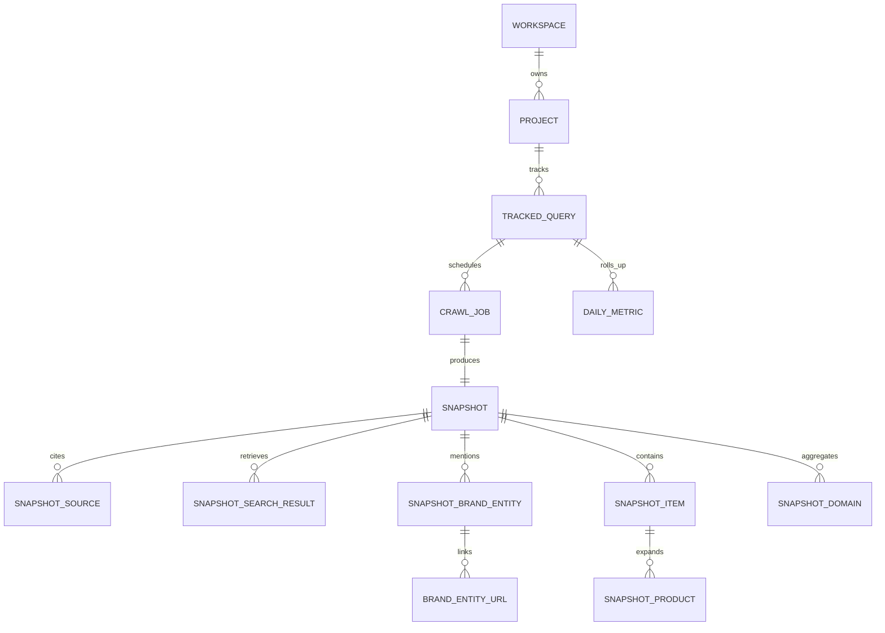
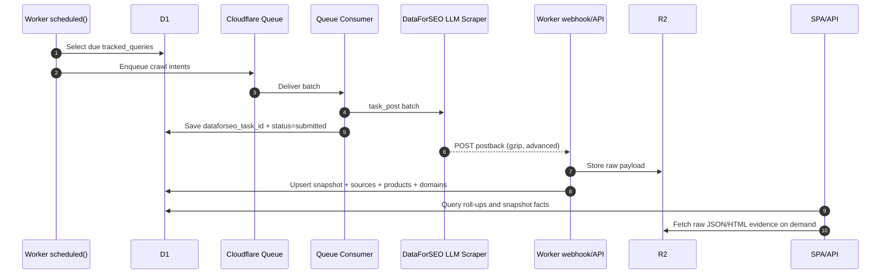

# ChatGPT Web LLM Tracker on Cloudflare with DataForSEO LLM Scraper

## Executive summary

A ChatGPT web-only LLM tracker built on Cloudflare Workers is technically feasible, and the best-fit design is a **Worker-first, queue-backed ingestion system** that uses **DataForSEO ChatGPT LLM Scraper** as the source of truth for public ChatGPT Search-mode results, **D1** for relational analytics and indexing, and **R2** for raw payload and HTML retention. This design matches the “Peec AI-style” product shape well because DataForSEO’s ChatGPT LLM Scraper returns the exact categories that matter for visibility tracking: cited sources, search-result URLs, brand entities, result item types, product blocks, source metadata, timestamps, and a direct `check_url` back to the ChatGPT web result. Crucially, the tracker should use **LLM Scraper**, not **LLM Responses**, because DataForSEO describes LLM Scraper as scraped ChatGPT Search-mode output, whereas LLM Responses is a separate API that generates structured model responses and would blur the line between web ChatGPT behaviour and API/model testing. citeturn26view1turn7search0turn26view0

For day-to-day monitoring, the most economical architecture is **Standard task posting with `postback_url`** for Advanced payloads, plus **Cloudflare Queues** between scheduling and submission/persistence. DataForSEO lets you post up to 100 tasks per Standard POST call, supports `postback_url` and `pingback_url`, returns gzip-compressed postbacks, and moves failed postbacks to `tasks_ready`; by contrast, `live/advanced` supports only one task per call and can take up to 120 seconds. That makes Live ideal for **manual refresh / ad hoc debugging**, but not as the default monitoring path. citeturn38view0turn13view0turn8view0turn38view1

On Cloudflare, **Workers Paid** is the practical production baseline. Workers include 10 million requests and 30 million CPU milliseconds per month on the paid plan; D1 includes 25 billion rows read and 50 million rows written per month; and R2 includes 10 GB-month of storage, 1 million Class A operations, and 10 million Class B operations per month. For this product, Cloudflare infrastructure spend is likely to be modest relative to DataForSEO API spend, because DataForSEO’s LLM Scraper pricing starts at **$0.0012** per Standard queue result page, **$0.0024** for high-priority queue, and **$0.004** for Live. citeturn15view0turn14view1turn15view1turn23search0

The strongest implementation choice is therefore:

* **Default ingestion:** DataForSEO Standard task POST + `postback_url` with `postback_data=advanced`
* **Manual refresh:** DataForSEO `live/advanced`
* **Evidence retention:** optional HTML capture in R2 when citation auditing is enabled
* **Storage pattern:** D1 for queryable facts, R2 for raw JSON/HTML blobs
* **Deployment model:** one public repo, Cloudflare Deploy button, Workers Static Assets + Vite React SPA + Worker API, with auto-provisioned D1/R2/Queues via Wrangler configuration. citeturn14view4turn28view4turn30view1turn30view3

The report below assumes the following defaults because they were unspecified:

| Assumption | Working default | Why it matters |
|---|---:|---|
| Monthly scrape volume | 100,000 tracked query-runs/month | Drives DataForSEO cost and queue sizing |
| Manual refresh share | 5% of runs | Determines Live API spend |
| Retention in D1 | 12 months hot analytics | Drives D1 size and roll-up strategy |
| Retention in R2 | 24 months raw JSON/HTML | Enables audit trails and backfills |
| Primary locales at launch | UK + US, English | Simplifies initial location/language handling |
| Tenant model | Single-tenant or light multi-tenant SaaS | Keeps first schema simple |
| PII policy | No end-user personal prompts stored | Reduces privacy/compliance scope |

## Feasibility and architecture recommendation

The product is feasible because each major requirement has a native system or field match:

* **ChatGPT web result capture:** DataForSEO ChatGPT LLM Scraper explicitly targets ChatGPT Search mode and returns structured output for tracked prompts. citeturn7search0turn26view1
* **Global serverless execution:** Cloudflare Workers run globally and support APIs, background jobs, and static assets. citeturn22search11turn16view6turn30view1turn30view3
* **Structured SQL analytics:** D1 is a serverless SQL database with Worker bindings, migrations, Time Travel, and usage-based pricing. citeturn31search4turn16view0turn22search3turn16view3turn14view1
* **Raw evidence retention:** R2 provides low-cost object storage with Worker bindings and no egress charges. citeturn22search19turn14view2turn16view7
* **One-click deploy:** Cloudflare’s Deploy button can clone a public repo, provision D1/R2/Queues, and deploy the Worker. citeturn28view4

### Recommended deployment topology

Use a **single full-stack Worker application** with static assets for the SPA and `/api/*` routes handled by the Worker. Cloudflare’s React/Vite guidance explicitly supports a front-end SPA plus a Worker backend API, and Workers Static Assets supports SPA routing plus `run_worker_first` on `/api/*`. citeturn30view0turn30view2turn30view3

Recommended topology:

* **React + Vite + shadcn/ui SPA** served as static assets
* **Main Worker** serving API routes
* **`scheduled()` handler** to enqueue due crawls
* **Queue producer/consumer** for crawl dispatch and persistence
* **Webhook endpoint** for DataForSEO postbacks
* **D1** for indexed, queryable facts
* **R2** for raw JSON, optional HTML evidence, and retry dead-letter exports. citeturn16view6turn16view4turn34search1turn34search4turn16view7

### Delivery-model choice

| Option | Best use | Operational profile | Recommendation |
|---|---|---|---|
| **Standard POST + postback** | Scheduled monitoring at scale | Up to 100 tasks per POST; lower cost; webhook on completion; failed postbacks fall back to `tasks_ready` | **Primary mode** |
| **Standard POST + `tasks_ready` polling** | Fallback collection | `tasks_ready` is free, but limited to 20 calls/minute, up to 1000 completed tasks/call, with a small completion-delay caveat | **Fallback only** |
| **Live Advanced** | User-triggered refresh | One task per call; up to 120s execution; highest per-result cost | **Manual rerun only** |

These characteristics come directly from DataForSEO’s ChatGPT LLM Scraper overview, task POST, Live, Tasks Ready, and pricing documentation. citeturn7search0turn38view0turn38view1turn8view0turn23search0

### Webhook versus polling

| Approach | Strengths | Weaknesses | Verdict |
|---|---|---|---|
| **Webhook postback** | Lowest latency for Standard mode; avoids polling waste; DataForSEO can send full results to your URL | Must expose a secure endpoint; your endpoint must respond promptly or the task is moved to `tasks_ready` | **Preferred** |
| **Tasks Ready polling** | Simpler to reason about; no public webhook endpoint needed | Queue updated with a small delay; capped at 20 calls/min; extra collector loop | **Fallback path** |

DataForSEO states that if your server does not respond within 10 seconds, the connection is aborted and the task is transferred to `tasks_ready`; it also notes a small delay in the completed-task queue and recommends pingbacks/postbacks above roughly 1000 tasks/minute. citeturn38view0turn8view0

### D1 versus an external database

| Criterion | **D1** | **External Postgres via Hyperdrive** |
|---|---|---|
| Operational simplicity | Excellent: native Worker binding, migration workflow, Time Travel | Good, but introduces external database lifecycle and connection string management |
| Read/write model | SQLite semantics; single-threaded per database; ideal for modest analytic workloads | Better fit for heavier concurrent writes and complex analytical SQL |
| Scale profile | 10 GB max per database; designed for horizontal scale across many smaller DBs | More flexible if you already need a large regional database |
| Edge integration | Native | Strong with Hyperdrive connection pooling and acceleration |
| Recommendation for this product | **Best MVP / early production fit** | Consider only after D1 size or throughput becomes a real constraint |

Cloudflare documents D1 as a serverless SQL database with SQLite semantics and built-in disaster recovery, notes that each D1 database is single-threaded and capped at 10 GB, and positions Hyperdrive as a way to accelerate queries to existing Postgres/MySQL databases from Workers. citeturn31search4turn35view0turn35view2turn26view3

**Conclusion:** use **D1 first**, but design shardability by workspace if you later approach the 10 GB/database ceiling or materially higher write concurrency. citeturn35view0turn35view2

## DataForSEO endpoint mapping and feature coverage

The tracker should be scoped to the following DataForSEO endpoints:

| Purpose | Endpoint | Why it exists |
|---|---|---|
| Create scheduled monitoring jobs | `POST /v3/ai_optimization/chat_gpt/llm_scraper/task_post` | Cheapest scalable ingestion path with batching and postbacks |
| Collect completed tasks as fallback | `GET /v3/ai_optimization/chat_gpt/llm_scraper/tasks_ready` | Recovery path for failed postbacks or if you choose polling |
| Retrieve structured result | `GET /v3/ai_optimization/chat_gpt/llm_scraper/task_get/advanced/$id` | Normalised result for analytics and UI |
| Run manual on-demand refresh | `POST /v3/ai_optimization/chat_gpt/llm_scraper/live/advanced` | Immediate refresh button in the UI |
| Validate locale options | `GET /v3/ai_optimization/chat_gpt/llm_scraper/locations` and `/languages` | Drive setup forms and validation |
| Optional HTML evidence capture | `.../live/html` or task `endpoint_html` | Auditability for citation-bar or visual parity workflows |

DataForSEO’s own docs describe the Standard and Live methods, the ChatGPT-specific locations/languages endpoints, and the availability of separate Advanced and HTML result endpoints. citeturn7search0turn38view0turn24search4turn24search0turn25view2turn8view0

### Field-level mapping to product features

| Product feature | DataForSEO field(s) | Notes |
|---|---|---|
| Brand mentions | `brand_entities[]` with `title`, `category`, `markdown`, `urls[]` | Primary source for explicit brand extraction |
| Citations / sources | `sources[]` with `title`, `snippet`, `domain`, `url`, `thumbnail`, `source_name`, `publication_date`, `markdown` | These are the sources actually cited or relied upon |
| Domain mentions | `sources.domain`, `search_results.domain`, `brand_entities.urls.domain`, product `domain`, local-business `domain` | Best stored as a derived domain roll-up |
| Product carousels | `items[]` where `type = "chat_gpt_products"` | Persist both the block and each product |
| Shopping data | product `title`, `price`, `currency`, `tag`, `url`, `domain`, `images[]`, `product_ids[]`, `merchants`, `id_to_token_map` | Enough for a strong shopping UI |
| Snippets | `sources.snippet`, `search_results.description`, element `markdown` | Supports “why cited” previews |
| Timestamps | result `datetime`, source `publication_date`, HTML item `date` | Use UTC end-to-end |
| URLs | result `check_url`, search result `url`, source `url`, brand URL, product `url` | `check_url` is especially valuable for QA |
| Metadata | task `status_code`, `status_message`, `time`, `cost`, `path`, `data`, plus result `model`, `item_types`, `items_count`, `se_results_count`, `fan_out_queries` | Keep both ingestion and product metadata |

The mappings above are drawn from the Task GET Advanced schema and examples, plus the HTML endpoint schema for page-level timestamping. citeturn39view3turn39view0turn39view1turn39view2turn40view0turn40view1turn40view2turn25view2

A particularly important distinction is that `search_results[]` includes **all web search outputs the model retrieved**, including duplicates and unused entries, while `sources[]` contains the sources the model **actually cited or relied on**. For a tracker, that means “visibility” and “citation share” are different metrics and should not be collapsed into one. citeturn39view3

### Recommended API usage pattern

Use the Standard endpoint for batch monitoring:

```json
POST /v3/ai_optimization/chat_gpt/llm_scraper/task_post
[
  {
    "keyword": "best project management software for remote teams",
    "location_code": 2826,
    "language_code": "en",
    "priority": 1,
    "force_web_search": true,
    "tag": "project=acme|query=pm-remote|run=2026-07-27T00:00:00Z",
    "postback_url": "https://tracker.example.com/api/webhooks/dataforseo/chatgpt?id=$id&tag=$tag",
    "postback_data": "advanced"
  }
]
```

Use the Live endpoint for a UI “Refresh now” action:

```json
POST /v3/ai_optimization/chat_gpt/llm_scraper/live/advanced
[
  {
    "keyword": "best project management software for remote teams",
    "location_code": 2826,
    "language_code": "en",
    "force_web_search": true,
    "tag": "manual-refresh:pm-remote"
  }
]
```

The Standard task POST endpoint accepts up to 100 tasks per request, while the Live endpoint accepts only one task per call. Both require `keyword` and either `location_code`/`location_name` plus `language_code`/`language_name`; `force_web_search` is optional and does not guarantee sources. citeturn38view0turn38view1

### Subtleties that matter in implementation

**Use `force_web_search=true` by default for monitoring queries**. The docs say it forces the AI agent to use web search and cite current web information, while also warning that citations are still not guaranteed. That is exactly the right trade-off for a visibility tracker: prioritise web-grounded behaviour, then measure when sources are absent. citeturn38view0turn38view1turn25view0

**Store `model` every time.** DataForSEO returns the ChatGPT model version in the result payload. If visibility shifts, you will want to distinguish “ranking/citation change” from “model version change”. citeturn39view3

**Treat `item_types` as part of product analytics.** If a query suddenly gains `chat_gpt_products` or `chat_gpt_navigation_list`, that is often more meaningful than a small textual wording change. citeturn39view2turn40view4

## Data model and storage design

The schema should separate **tracked intent**, **crawl execution**, **captured snapshot**, and **normalised entities**. The design below keeps D1 focused on indexed analytics while offloading large payloads to R2, which is important because D1 rows are capped at 2 MB, SQL statements at 100 KB, and each D1 database at 10 GB. citeturn35view0turn35view3

### Recommended logical model



This ER shape is a direct fit for DataForSEO’s field model: one run leads to one result snapshot, which then expands into sources, search results, brand entities, item blocks, and products. citeturn39view3turn39view2turn40view0turn40view2

### Core D1 tables

The core tables should be:

| Table | Purpose | Retention |
|---|---|---|
| `workspaces` | Tenant/account boundary | Permanent |
| `projects` | Brand or campaign grouping | Permanent |
| `tracked_queries` | Each monitored prompt + locale + schedule | Permanent |
| `crawl_jobs` | Submission and delivery lifecycle | 12–24 months |
| `snapshots` | One structured result per completed run | 12 months hot |
| `snapshot_sources` | Actual citations | 12 months hot |
| `snapshot_search_results` | All retrieved web results | 12 months hot |
| `snapshot_brand_entities` | Brand visibility facts | 12 months hot |
| `brand_entity_urls` | URLs linked to a brand entity | 12 months hot |
| `snapshot_items` | Raw item blocks by type | 12 months hot |
| `snapshot_products` | Expanded shopping rows | 12 months hot |
| `snapshot_domains` | Derived domain roll-up per snapshot | 12 months hot |
| `daily_metrics` | Pre-aggregated dashboard facts | 24 months |
| `ingest_events` | Webhook receipts / error audit | 30–90 days |

### Example D1 schema

```sql
CREATE TABLE workspaces (
  id TEXT PRIMARY KEY,
  name TEXT NOT NULL,
  created_at TEXT NOT NULL DEFAULT CURRENT_TIMESTAMP
);

CREATE TABLE projects (
  id TEXT PRIMARY KEY,
  workspace_id TEXT NOT NULL,
  name TEXT NOT NULL,
  primary_domain TEXT,
  brand_terms_json TEXT,          -- JSON array
  competitor_terms_json TEXT,     -- JSON array
  settings_json TEXT,             -- JSON object
  created_at TEXT NOT NULL DEFAULT CURRENT_TIMESTAMP,
  FOREIGN KEY (workspace_id) REFERENCES workspaces(id)
);

CREATE TABLE tracked_queries (
  id TEXT PRIMARY KEY,
  project_id TEXT NOT NULL,
  query_text TEXT NOT NULL,
  location_code INTEGER NOT NULL,
  language_code TEXT NOT NULL,
  force_web_search INTEGER NOT NULL DEFAULT 1,
  cadence_cron TEXT NOT NULL,
  is_active INTEGER NOT NULL DEFAULT 1,
  created_at TEXT NOT NULL DEFAULT CURRENT_TIMESTAMP,
  FOREIGN KEY (project_id) REFERENCES projects(id)
);

CREATE TABLE crawl_jobs (
  id TEXT PRIMARY KEY,
  tracked_query_id TEXT NOT NULL,
  run_type TEXT NOT NULL,         -- scheduled | manual | backfill
  delivery_method TEXT NOT NULL,  -- standard_postback | standard_poll | live
  status TEXT NOT NULL,           -- queued | submitted | completed | failed
  dataforseo_task_id TEXT,
  priority INTEGER,
  tag TEXT,
  request_cost_usd REAL,
  task_status_code INTEGER,
  task_status_message TEXT,
  submitted_at TEXT,
  completed_at TEXT,
  error_message TEXT,
  FOREIGN KEY (tracked_query_id) REFERENCES tracked_queries(id)
);

CREATE TABLE snapshots (
  id TEXT PRIMARY KEY,
  crawl_job_id TEXT NOT NULL UNIQUE,
  keyword TEXT NOT NULL,
  location_code INTEGER NOT NULL,
  language_code TEXT NOT NULL,
  model TEXT,
  check_url TEXT,
  captured_at_utc TEXT NOT NULL,
  markdown TEXT,
  se_results_count INTEGER,
  items_count INTEGER,
  item_types_json TEXT,           -- JSON array
  fan_out_queries_json TEXT,      -- JSON array
  raw_json_r2_key TEXT,
  html_r2_key TEXT,
  FOREIGN KEY (crawl_job_id) REFERENCES crawl_jobs(id)
);

CREATE TABLE snapshot_sources (
  id TEXT PRIMARY KEY,
  snapshot_id TEXT NOT NULL,
  ordinal INTEGER NOT NULL,
  title TEXT,
  snippet TEXT,
  source_name TEXT,
  domain TEXT,
  url TEXT,
  thumbnail TEXT,
  publication_date TEXT,
  markdown TEXT,
  FOREIGN KEY (snapshot_id) REFERENCES snapshots(id)
);

CREATE TABLE snapshot_brand_entities (
  id TEXT PRIMARY KEY,
  snapshot_id TEXT NOT NULL,
  ordinal INTEGER NOT NULL,
  title TEXT NOT NULL,
  category TEXT,
  markdown TEXT,
  FOREIGN KEY (snapshot_id) REFERENCES snapshots(id)
);

CREATE TABLE brand_entity_urls (
  id TEXT PRIMARY KEY,
  brand_entity_id TEXT NOT NULL,
  ordinal INTEGER NOT NULL,
  url TEXT,
  domain TEXT,
  FOREIGN KEY (brand_entity_id) REFERENCES snapshot_brand_entities(id)
);

CREATE TABLE snapshot_domains (
  id TEXT PRIMARY KEY,
  snapshot_id TEXT NOT NULL,
  domain TEXT NOT NULL,
  cited_count INTEGER NOT NULL DEFAULT 0,
  retrieved_count INTEGER NOT NULL DEFAULT 0,
  brand_url_count INTEGER NOT NULL DEFAULT 0,
  product_count INTEGER NOT NULL DEFAULT 0,
  local_business_count INTEGER NOT NULL DEFAULT 0,
  first_seen_at TEXT NOT NULL,
  FOREIGN KEY (snapshot_id) REFERENCES snapshots(id)
);

CREATE TABLE snapshot_products (
  id TEXT PRIMARY KEY,
  snapshot_id TEXT NOT NULL,
  item_rank_absolute INTEGER,
  ordinal INTEGER NOT NULL,
  product_id TEXT,
  merchants TEXT,
  id_to_token_map TEXT,
  title TEXT,
  price REAL,
  currency TEXT,
  tag TEXT,
  url TEXT,
  domain TEXT,
  rating_value REAL,
  rating_votes_count INTEGER,
  rating_max INTEGER,
  images_json TEXT,               -- JSON array
  shopping_ids_json TEXT,         -- JSON array/object
  FOREIGN KEY (snapshot_id) REFERENCES snapshots(id)
);

CREATE INDEX idx_queries_project_active
  ON tracked_queries(project_id, is_active);

CREATE INDEX idx_jobs_query_status_time
  ON crawl_jobs(tracked_query_id, status, submitted_at);

CREATE INDEX idx_snapshots_captured
  ON snapshots(captured_at_utc DESC);

CREATE INDEX idx_sources_snapshot_domain
  ON snapshot_sources(snapshot_id, domain);

CREATE INDEX idx_domains_snapshot_domain
  ON snapshot_domains(snapshot_id, domain);

CREATE INDEX idx_products_snapshot_domain
  ON snapshot_products(snapshot_id, domain);
```

This schema is intentionally hybrid: strongly structured for dashboard-critical facts, but JSON-backed for variable nested payloads. That balances D1’s SQL strengths with its per-row and per-database limits. Cloudflare recommends prepared statements and supports batching via `db.batch()`, while D1 throughput depends heavily on query performance and indexing. citeturn37view0turn37view1turn35view2

### R2 usage strategy

Use **R2 selectively**, not as the primary query store.

| Artefact | Store in D1? | Store in R2? | Rationale |
|---|---|---|---|
| Normalised sources / products / brands | Yes | No | Needed for dashboard queries |
| Full DataForSEO result JSON | No | Yes | Audit trail, replay, debugging |
| Optional HTML response | No | Yes | Visual evidence / citation QA |
| Derived aggregates | Yes | No | Fast dashboards |
| Remote images from products/sources | No | Usually no | URLs are enough unless link-rot archiving is required |

R2 is the right place for the large unstructured data because it is designed for object storage, is inexpensive, and binds directly into Workers. D1 should keep only what you index and query. citeturn16view7turn14view2turn33view1

A sensible retention policy is:

* **D1 hot facts:** 12 months
* **R2 raw JSON:** 24 months
* **R2 HTML evidence:** 90–180 days by default, longer only for enterprise audit requirements
* **Daily roll-ups:** keep indefinitely unless tenant policy requires deletion

## Ingestion pipeline and Worker design

The ingestion pipeline should be built around Cloudflare’s strengths: **scheduled triggers**, **Queues for buffering/retries**, **Worker webhook ingestion**, **D1 for state**, and **R2 for evidence**. Cron Triggers are explicitly intended for calling third-party APIs to collect up-to-date data; Queues are intended for guaranteed delivery, batching, retries, and rate-limited upstream APIs. citeturn16view6turn16view4turn34search14

### End-to-end flow



This flow reflects DataForSEO’s Standard task lifecycle, Cloudflare scheduled Workers, and Cloudflare Queues’ batching/retry model. citeturn38view0turn8view0turn16view6turn34search1turn34search4

### Suggested Worker responsibilities

| Worker surface | Responsibility |
|---|---|
| `scheduled()` | Find due queries, enqueue crawl intents |
| `queue()` consumer | Submit batched Standard tasks to DataForSEO; apply rate limits |
| `fetch()` `/api/*` | Serve analytics and snapshot APIs to the SPA |
| `fetch()` `/api/webhooks/dataforseo/chatgpt` | Receive postbacks, validate, persist |
| `fetch()` `/api/manual-refresh/:queryId` | Run `live/advanced` for ad hoc refresh |
| `fetch()` `/api/evidence/:snapshotId` | Return signed or proxied R2 artefacts |

### Rate limiting, retries, and batching

**DataForSEO constraints**

* Standard Task POST: up to **2000 API calls/minute**, **100 tasks per POST**. citeturn38view0
* Live Advanced: up to **2000 API calls/minute**, **one task per call**, current execution up to **120 seconds**. citeturn38view1
* Tasks Ready: **20 API calls/minute**, **1000 tasks/call**, retains uncollected tasks for up to **three days**. citeturn8view0

**Cloudflare Queue constraints**

* Maximum batch size: **100 messages**
* Maximum `sendBatch` size: **100 messages / 256 KB**
* Default consumer batching: configurable with `max_batch_size` and `max_batch_timeout`
* Concurrency is autoscaled and can be capped with `max_concurrency`
* Queue consumers inherit Worker CPU limits; message retention is configurable up to 14 days on paid plans. citeturn34search3turn34search1turn34search0turn36view0

**Recommended queue settings**

* `max_batch_size = 20`
* `max_batch_timeout = 5s`
* `max_concurrency = 2` initially
* Retry delay = 30s, max retries = 5
* Dead-letter queue enabled for poisoned messages

Those settings are conservative enough to stay far below DataForSEO’s headline limits while still handling bursts cleanly. The batch size should be tied to **upstream batch POST size** rather than D1 write size. citeturn38view0turn34search1turn34search5

### Recommended pseudo-code

```ts
export interface Env {
  DB: D1Database
  RAW_BUCKET: R2Bucket
  INGEST_QUEUE: Queue<CrawlIntent>
  DATAFORSEO_LOGIN: string
  DATAFORSEO_PASSWORD: string
  WEBHOOK_SHARED_SECRET: string
}

export default {
  async scheduled(_event: ScheduledEvent, env: Env) {
    const due = await env.DB.prepare(`
      SELECT id, query_text, location_code, language_code, force_web_search
      FROM tracked_queries
      WHERE is_active = 1
        AND id IN (
          SELECT tracked_query_id
          FROM due_queries_view
        )
      LIMIT 500
    `).all<CrawlIntent>()

    const messages = due.results.map((q) => ({
      body: { ...q, runType: "scheduled" }
    }))

    for (let i = 0; i < messages.length; i += 100) {
      await env.INGEST_QUEUE.sendBatch(messages.slice(i, i + 100))
    }
  },

  async queue(batch: MessageBatch<CrawlIntent>, env: Env) {
    const apiAuth = "Basic " + btoa(`${env.DATAFORSEO_LOGIN}:${env.DATAFORSEO_PASSWORD}`)

    const tasks = batch.messages.slice(0, 100).map((m) => ({
      keyword: m.body.query_text,
      location_code: m.body.location_code,
      language_code: m.body.language_code,
      force_web_search: !!m.body.force_web_search,
      tag: `query=${m.body.id}|ts=${new Date().toISOString()}`,
      postback_url: `https://tracker.example.com/api/webhooks/dataforseo/chatgpt?secret=${env.WEBHOOK_SHARED_SECRET}&id=$id&tag=$tag`,
      postback_data: "advanced"
    }))

    const res = await fetch(
      "https://api.dataforseo.com/v3/ai_optimization/chat_gpt/llm_scraper/task_post",
      {
        method: "POST",
        headers: {
          "Authorization": apiAuth,
          "Content-Type": "application/json"
        },
        body: JSON.stringify(tasks)
      }
    )

    if (!res.ok) throw new Error(`DataForSEO task_post failed: ${res.status}`)

    const payload = await res.json<any>()

    // Persist task IDs, status, cost metadata
    const stmts = []
    for (const task of payload.tasks ?? []) {
      const originalTag = task.data?.tag ?? null
      stmts.push(
        env.DB.prepare(`
          INSERT INTO crawl_jobs (
            id, tracked_query_id, run_type, delivery_method, status,
            dataforseo_task_id, tag, request_cost_usd, task_status_code,
            task_status_message, submitted_at
          ) VALUES (?, ?, 'scheduled', 'standard_postback', 'submitted',
                    ?, ?, ?, ?, ?, CURRENT_TIMESTAMP)
        `).bind(
          crypto.randomUUID(),
          parseTrackedQueryIdFromTag(originalTag),
          task.id,
          originalTag,
          task.cost ?? null,
          task.status_code ?? null,
          task.status_message ?? null
        )
      )
    }

    if (stmts.length) await env.DB.batch(stmts)
    batch.ackAll()
  },

  async fetch(request: Request, env: Env): Promise<Response> {
    const url = new URL(request.url)

    if (url.pathname === "/api/webhooks/dataforseo/chatgpt" && request.method === "POST") {
      const secret = url.searchParams.get("secret")
      if (secret !== env.WEBHOOK_SHARED_SECRET) {
        return new Response("unauthorised", { status: 401 })
      }

      const raw = await request.arrayBuffer()
      const rawKey = `raw/${Date.now()}-${crypto.randomUUID()}.json.gz`
      await env.RAW_BUCKET.put(rawKey, raw, {
        httpMetadata: { contentType: "application/json" }
      })

      const payload = await decodeIfGzipAndParse(raw, request.headers)
      await persistAdvancedPayload(env.DB, payload, rawKey)

      return new Response("ok")
    }

    return new Response("not found", { status: 404 })
  }
}
```

This pseudo-code follows the documented DataForSEO authentication and Standard task-post pattern, Cloudflare Queue batch handling, and D1 batch writes. DataForSEO examples use HTTP Basic authentication with account credentials; D1 supports prepared statements and ordered `batch()` execution. citeturn8view0turn38view0turn37view0

### Implementation notes that reduce risk

**Claim-and-write discipline in D1.** Because each D1 database is single-threaded and processes queries one at a time, avoid giant write transactions; insert in compact batches and keep high-cardinality analytics pre-aggregated. citeturn35view2

**Store raw first, normalise second.** On webhook receipt, write the raw payload to R2 before attempting deep normalisation. That gives you recovery, replay, and debugging headroom if a schema edge case appears. This is an implementation inference, but it aligns with R2’s role as low-cost object storage and D1’s limited row sizes. citeturn22search19turn35view0turn33view1

**Prefer prepared statements.** D1’s prepared-statement API and `batch()` model are better than building large dynamic SQL strings, and they help keep sensitive values out of captured query text in D1 observability. D1 Insights captures query strings but not bound parameters. citeturn16view1turn37view0turn31search0

## Deployment, operations, security, and compliance

### Repository structure

A practical mono-app repository layout is:

```text
chatgpt-web-tracker/
├─ src/
│  ├─ worker/
│  │  ├─ index.ts
│  │  ├─ routes/
│  │  ├─ ingestion/
│  │  ├─ normalisers/
│  │  └─ lib/
│  ├─ app/
│  │  ├─ pages/
│  │  ├─ components/
│  │  │  ├─ ui/
│  │  │  └─ charts/
│  │  ├─ hooks/
│  │  └─ state/
│  └─ shared/
│     ├─ types.ts
│     └─ zod.ts
├─ migrations/
│  └─ 0001_init.sql
├─ public/
├─ package.json
├─ vite.config.ts
├─ wrangler.jsonc
├─ .dev.vars.example
├─ .github/workflows/
│  ├─ ci.yml
│  └─ deploy.yml
└─ README.md
```

Cloudflare’s Vite plugin supports full-stack applications with static assets and Worker APIs, and Cloudflare’s React guide explicitly expects the front-end to call a Worker backend for bindings access. citeturn30view1turn30view0turn30view2

### Cloudflare deployment steps

A clean setup flow is:

1. Scaffold with C3 or start from a React/Vite template. Cloudflare documents `npm create cloudflare@latest` as the entry point for new Worker projects. citeturn22search2turn22search5
2. Add the Cloudflare Vite plugin and configure SPA asset routing. citeturn29search4turn30view2turn30view3
3. Create a D1 database, bind it in `wrangler.jsonc`, and create/apply migrations. Cloudflare’s D1 getting-started and migration docs cover this workflow. citeturn22search6turn22search3turn22search0
4. Create an R2 bucket and bind it to the Worker. citeturn22search1turn16view7
5. Create one or two Queues if using buffered ingestion. citeturn16view4turn34search5
6. Add required secrets with Wrangler or the dashboard. citeturn14view5turn16view9
7. Deploy with `wrangler deploy` or Workers Builds. citeturn10search7turn14view3

### Example `wrangler.jsonc`

```jsonc
{
  "$schema": "./node_modules/wrangler/config-schema.json",
  "name": "chatgpt-web-tracker",
  "compatibility_date": "2026-07-27",
  "main": "./src/worker/index.ts",
  "assets": {
    "directory": "./dist",
    "not_found_handling": "single-page-application",
    "binding": "ASSETS",
    "run_worker_first": ["/api/*"]
  },
  "triggers": {
    "crons": ["*/15 * * * *"]
  },
  "d1_databases": [
    {
      "binding": "DB",
      "database_name": "chatgpt-web-tracker-db",
      "database_id": "REPLACED_BY_DEPLOY",
      "migrations_dir": "./migrations"
    }
  ],
  "r2_buckets": [
    {
      "binding": "RAW_BUCKET",
      "bucket_name": "chatgpt-web-tracker-raw"
    }
  ],
  "queues": {
    "producers": [
      { "binding": "INGEST_QUEUE", "queue": "chatgpt-web-tracker-ingest" }
    ],
    "consumers": [
      {
        "queue": "chatgpt-web-tracker-ingest",
        "max_batch_size": 20,
        "max_batch_timeout": 5,
        "max_concurrency": 2,
        "max_retries": 5,
        "dead_letter_queue": "chatgpt-web-tracker-dlq"
      }
    ]
  },
  "secrets": {
    "required": [
      "DATAFORSEO_LOGIN",
      "DATAFORSEO_PASSWORD",
      "WEBHOOK_SHARED_SECRET"
    ]
  }
}
```

This configuration is consistent with Cloudflare’s Workers Static Assets, Cron Triggers, D1 bindings, R2 bindings, Queue consumer settings, and secrets validation model. citeturn30view3turn10search5turn16view7turn34search11turn14view5turn16view9

### Cloudflare Deploy button

Cloudflare documents the deploy button snippet as:

```md
[](https://deploy.workers.cloudflare.com/?url=<YOUR_REPO_URL>)
```

Recommended README usage:

```md
[](https://deploy.workers.cloudflare.com/?url=https://github.com/your-org/chatgpt-web-tracker)
```

Cloudflare states that Deploy buttons can clone a public GitHub/GitLab repo, configure the Worker, provision resources such as D1, R2, Hyperdrive, Secrets Store, and Queues, and then build and deploy the app. It also supports describing required bindings in `package.json` for a better setup experience. citeturn14view4turn28view4turn28view0

### CI/CD

There are two good CI/CD patterns:

| Pattern | Strengths | Recommendation |
|---|---|---|
| **Workers Builds** | Native preview URLs, Git-connected deployments, minimal YAML | Best default for maintainers |
| **GitHub Actions + `cloudflare/wrangler-action@v3`** | More control over lint/test/deploy gates | Use if you need explicit release workflows |

Cloudflare documents both Workers Builds from Git repositories and an official GitHub Action for Worker deployment. citeturn14view3turn16view8

Recommended pipeline:

* `ci.yml`: install, type-check, lint, unit test, migration dry-run
* `deploy.yml`: only for tagged releases or `main`, uses Wrangler action
* Workers Builds: enabled for preview deployments on PRs if you want the simplest preview model

### Observability

Use Cloudflare’s native observability first:

* **Workers Logs** for request and application logs; enabled by default on newly created Workers. citeturn16view10
* **Workers metrics and Query Builder** for request counts, errors, CPU time, wall time, and execution duration. citeturn14view6turn31search11
* **D1 insights and billing metrics** for query performance, rows read/written, and storage. D1 captures query strings, but bound parameters are not captured. citeturn31search0turn31search8turn31search1
* **R2 metrics** for storage and operations. citeturn31search2
* **Queues metrics** for backlog, consumer concurrency, and message operations. citeturn34search8

Operational SLOs worth tracking:

| Metric | Target |
|---|---:|
| Scheduled query enqueue lag | < 2 minutes |
| Postback-to-persist latency | < 10 seconds p95 |
| Queue backlog age | < 5 minutes p95 |
| Snapshot persist failure rate | < 0.5% |
| Manual refresh completion | < 120 seconds p95 |
| API dashboard latency | < 500 ms p95 for roll-ups |

### Security and authentication

DataForSEO examples use **HTTP Basic authentication** with the account login and password from the API access page. In Cloudflare, those should be stored as separate Worker secrets and combined at runtime into the `Authorization: Basic …` header. citeturn8view0turn14view5

Recommended secrets:

| Secret | Purpose |
|---|---|
| `DATAFORSEO_LOGIN` | DataForSEO API username |
| `DATAFORSEO_PASSWORD` | DataForSEO API password |
| `WEBHOOK_SHARED_SECRET` | Shared secret embedded in postback URL |
| `APP_SESSION_SECRET` | SPA/admin session signing |
| `ENCRYPTION_KEY` | Optional application-level encryption for sensitive columns |

Cloudflare supports required-secret validation in Wrangler config and secret upload via `wrangler secret put` or bulk files. citeturn14view5turn16view9

**Webhook hardening:** the retrieved DataForSEO docs describe `postback_url` and `pingback_url` behaviour, gzip compression, and timeout handling, but they do not describe a first-party signature mechanism in the pages captured here. The prudent pattern is therefore:

* embed a strong shared secret in the postback URL,
* optionally IP-allowlist if DataForSEO publishes stable ranges through separate support material,
* persist raw payload, then
* verify task identity against the known `dataforseo_task_id` before mutating state.

The last two items are implementation recommendations based on the documented webhook model. citeturn13view0turn38view0

### Privacy and compliance

The main compliance question is not whether the system can be secured — Cloudflare documents encryption at rest and in transit for both D1 and R2 — but whether the **tracked prompts and returned artefacts contain personal or regulated data**. D1 encrypts stored data with AES-256 and secures transport with TLS; R2 provides the same class of protection for stored objects. citeturn33view0turn33view1

Important privacy considerations:

* **Do not store user-authored free-text prompts unless business-necessary.** If the product is an SEO/GEO tracker, tracked prompts should usually be campaign-owned, not personal.
* **Use bound parameters for D1 queries.** D1 insights capture query strings but not bound parameters, which is a strong reason not to interpolate sensitive values directly into SQL. citeturn31search0turn16view1
* **Minimise raw HTML retention.** HTML evidence is useful for audits, but it increases the volume of stored third-party content.
* **Declare DataForSEO as a processor/subprocessor in your vendor inventory.** DataForSEO’s privacy policy states it stores customers’ API task data for **365 days**. citeturn33view2
* **Give tenants purge controls.** At minimum: delete query, purge snapshots, purge raw evidence, export data.
* **Document provenance.** Every snapshot should retain `check_url`, `model`, `captured_at_utc`, and raw-object key so analysts can defend claims. citeturn39view0turn39view3

### Cost and limits estimate

#### Estimated monthly cost under assumptions

Assume **100,000 scheduled query-runs/month**, **5,000 manual Live refreshes/month**, one result page per run, average raw payload **25 KB**, and roughly **40 D1 rows written per completed snapshot**.

| Cost line | Estimate |
|---|---:|
| Workers Paid base | **$5.00** |
| DataForSEO Standard queue at $0.0012 × 100,000 | **$120.00** |
| DataForSEO Live at $0.004 × 5,000 | **$20.00** |
| D1 rows written | Likely **$0.00** under included 50M writes/month |
| D1 rows read | Likely **$0.00** under included 25B reads/month |
| R2 storage | Likely **$0.00** at ~2.5 GB raw/month within free 10 GB-month |
| Queues operations | Likely **$0.00** at 300,000 ops/month under 1M included |
| Logs | Likely **$0.00** for moderate usage under included limits |

Cloudflare pricing and DataForSEO pricing support the line-item rates above; the exact estimate is an analytical projection built on the stated assumptions. citeturn15view0turn14view1turn15view1turn14view2turn36view0turn23search0

#### Scale scenarios

| Volume | Standard-only DataForSEO | Live-only DataForSEO | Likely infra comment |
|---|---:|---:|---|
| 10,000 runs/month | $12 | $40 | Free/very low infra |
| 100,000 runs/month | $120 | $400 | Workers Paid recommended |
| 1,000,000 runs/month | $1,200 | $4,000 | Consider D1 sharding and tighter roll-ups |

The key strategic point is that **DataForSEO spend dominates** much earlier than Cloudflare spend. citeturn23search0turn15view0turn14view1turn14view2

### UI integration plan with shadcn/ui

A Peec-style dashboard maps very naturally onto shadcn/ui’s component catalogue:

| Page / surface | shadcn/ui components | Behaviour |
|---|---|---|
| App frame | `Sidebar`, `Breadcrumb`, `Tabs` | Workspace/project navigation and page sections |
| Query table | `Data Table`, `Pagination`, `Dropdown Menu`, `Badge` | Sort/filter by brand visibility, cited domains, locale, freshness |
| Snapshot detail | `Sheet` on desktop, `Drawer` on mobile | Side-panel drill-down without losing table context |
| Source explorer | `Command`, `Input`, `Tabs` | Search within sources/domains/citations |
| Trends dashboard | `Chart`, `Card`, `Tooltip` | Citation share, domain share, product-block frequency |
| Filters | `Combobox`, `Select`, `Date Picker`, `Checkbox` | Locale, date range, item type, cited-only |
| Toasts / jobs | `Toast`, `Progress`, `Skeleton` | Refresh feedback and loading states |

shadcn/ui documents these components directly, including Sidebar, Data Table, Pagination, Sheet, Tabs, Command, and Chart built on Recharts. citeturn20view4turn20view2turn20view7turn20view6turn20view8turn20view5turn20view3

**State management recommendation**

Use a **three-layer state model**:

* **Server state:** TanStack Query for `/api/*` data fetching, caching, invalidation, and “keep previous data” pagination behaviour. citeturn21search0turn21search9turn21search15
* **Table state:** TanStack Table integrated with shadcn Data Table for sorting, filters, column hide/show, row selection, and pagination. citeturn18search2turn20view2turn21search4
* **Local UI state:** React `useReducer` + `createContext` / `useContext` for filter panel state, selected snapshot, and modal/sheet coordination. citeturn21search2turn21search5turn21search8turn21search20

Recommended pages:

* **Overview** — KPI cards, trend charts, recently changed queries
* **Queries** — main sortable table of tracked prompts
* **Snapshot Explorer** — per-run evidence, citations, parsed products
* **Domains** — cited domain share and trend lines
* **Brands** — explicit brand-entity tracking over time
* **Settings** — locales, schedules, retention, secrets health, webhook diagnostics

## Product requirements document

### Product name

**ChatGPT Web Tracker**

### Product goal

Provide a Cloudflare-deployable SEO/GEO analytics application that tracks how **ChatGPT web Search mode** mentions brands, cites sources, surfaces domains, and displays product/shopping blocks for monitored prompts, without conflating those observations with OpenAI API or generic model-response benchmarking. The source of truth for ChatGPT web observations is DataForSEO ChatGPT LLM Scraper. citeturn7search0turn26view1

### Problem statement

Teams need an auditable way to answer:

* Is our brand cited by ChatGPT web for the prompts that matter?
* Which domains are cited instead of us?
* When do product carousels appear, and which merchants/products win?
* How does our visibility trend over time by query, category, and locale?

### Target users

* SEO / GEO teams
* Brand and content strategy teams
* Agencies managing multiple clients
* Product marketing and e-commerce teams
* Internal analytics teams validating ChatGPT web visibility

### In scope

* ChatGPT web Search-mode tracking only
* Scheduled tracking of prompts by project and locale
* Brand mention extraction
* Citation/source tracking
* Domain mention roll-ups
* Product carousel and shopping data extraction
* Snapshot history and trends
* Manual refresh
* Raw evidence retention in R2
* Cloudflare one-click deployment
* shadcn/ui dashboard

### Out of scope

* OpenAI API response tracking
* Synthetic direct model benchmarking across providers
* Ad tracking in MVP
* Full-text HTML archival of every run by default
* User-generated personal prompt storage
* Enterprise RBAC beyond basic workspace roles in MVP

### Functional requirements

#### Ingestion

* The system shall support Standard DataForSEO task creation for ChatGPT LLM Scraper with batched POST requests.
* The system shall support Live Advanced refresh for manual on-demand runs.
* The system shall support webhook postbacks for Standard completion.
* The system shall support `tasks_ready` polling as a fallback collector.
* The system shall validate location and language against DataForSEO-supported values. citeturn38view0turn38view1turn8view0turn24search4

#### Data capture

* The system shall store snapshot-level metadata including `model`, `check_url`, `datetime`, `item_types`, `items_count`, and `se_results_count`.
* The system shall store all `sources[]` entries as citations.
* The system shall store all `search_results[]` entries separately from `sources[]`.
* The system shall store all `brand_entities[]` and associated URLs.
* The system shall store all product block rows with shopping fields where present.
* The system shall compute per-snapshot domain mention roll-ups. citeturn39view0turn39view1turn39view2turn39view3turn40view0turn40view2

#### Analytics

* The system shall display citation share by project, query, domain, and date range.
* The system shall display brand mention frequency and change over time.
* The system shall display product-block appearance rate and extracted product details.
* The system shall distinguish retrieved search-result domains from actually cited source domains.
* The system shall enable snapshot diffing between adjacent runs.

#### User interface

* The system shall provide:
  * Overview dashboard
  * Query list
  * Snapshot detail explorer
  * Domain analytics
  * Brand analytics
  * Settings / diagnostics
* The UI shall use shadcn/ui components and be responsive on desktop and mobile. citeturn20view4turn20view2turn20view6turn20view3

### Non-functional requirements

* Default dashboard endpoints should return in under 500 ms p95 on warm paths.
* The ingestion pipeline should tolerate webhook failure, queue retries, and duplicate delivery.
* All writes should be idempotent by `dataforseo_task_id` and snapshot natural keys.
* Raw payloads should be written to R2 before deep normalisation.
* The platform should deploy from a public GitHub repo with a Cloudflare Deploy button. citeturn28view4turn16view4turn34search4

### Recommended MVP architecture

* **Frontend:** React + Vite + shadcn/ui
* **Backend:** Cloudflare Worker API routes
* **Scheduler:** Worker Cron Trigger
* **Buffering:** Cloudflare Queues
* **DB:** Cloudflare D1
* **Blob storage:** Cloudflare R2
* **External data source:** DataForSEO ChatGPT LLM Scraper Standard + Live
* **Deploy:** Cloudflare Deploy button + Workers Builds or GitHub Actions. citeturn16view6turn16view4turn31search4turn22search19turn28view4turn14view3turn16view8

### Acceptance criteria

* A user can deploy the repo to Cloudflare with one click.
* A user can create a project and tracked query with locale and schedule.
* A scheduled run creates a DataForSEO task and, on completion, stores a snapshot.
* A snapshot detail page shows:
  * final markdown,
  * model version,
  * check URL,
  * cited sources,
  * retrieved search results,
  * brand entities,
  * detected domains,
  * product cards when present.
* The overview page shows time-series charts and summary cards.
* Manual refresh creates a fresh run using Live Advanced and updates the UI.
* Webhook failures do not cause data loss; the system can recover via `tasks_ready`.
* Raw JSON evidence can be fetched for a snapshot by an authorised user.

### Delivery plan

**Phase one**
* Full-stack Worker app scaffold
* D1 schema + migrations
* Standard task submission
* Webhook ingestion
* Overview + Query List + Snapshot Detail UI
* Deploy button

**Phase two**
* Queues-based buffering and DLQ
* Product analytics pages
* Domain share charts
* Daily roll-ups and diff views
* HTML evidence capture option

**Phase three**
* Multi-tenant controls
* Workspace roles
* Sharded D1 strategy if required
* Enterprise retention and export controls

### Open questions

| Question | Why it matters |
|---|---|
| What monthly tracked-query volume is expected at launch? | Sets DataForSEO and queue economics |
| Which locations/languages must be supported in v1? | Affects schedule design and UI defaults |
| Is the tracker single-workspace or multi-tenant SaaS from day one? | Changes auth, schema, and deployment |
| How long must raw evidence be retained? | Determines R2 lifecycle policy |
| Is HTML evidence mandatory for all runs or only for audit mode? | Strongly affects storage growth |
| Are competitor brands pre-configured or ad hoc per project? | Affects entity normalisation and UI workflows |
| Is per-query alerting needed in MVP? | Would add notification channels and thresholds |
| Are there regulated-content constraints for tracked prompts? | May require stricter retention and purge tooling |

### Final recommendation

Build the first implementation with **DataForSEO Standard task POST + postback**, **Cloudflare Queues**, **D1 hot analytics**, **R2 raw evidence**, and a **React + shadcn/ui SPA on Workers Static Assets**. Reserve **Live Advanced** for manual refresh. Avoid LLM Responses entirely in the tracker core so that the product remains a faithful measurement of **ChatGPT web** behaviour rather than model/API output. This yields the best combination of cost efficiency, auditability, product clarity, and Cloudflare-native deployability. citeturn26view1turn26view0turn38view0turn38view1turn28view4turn30view1
